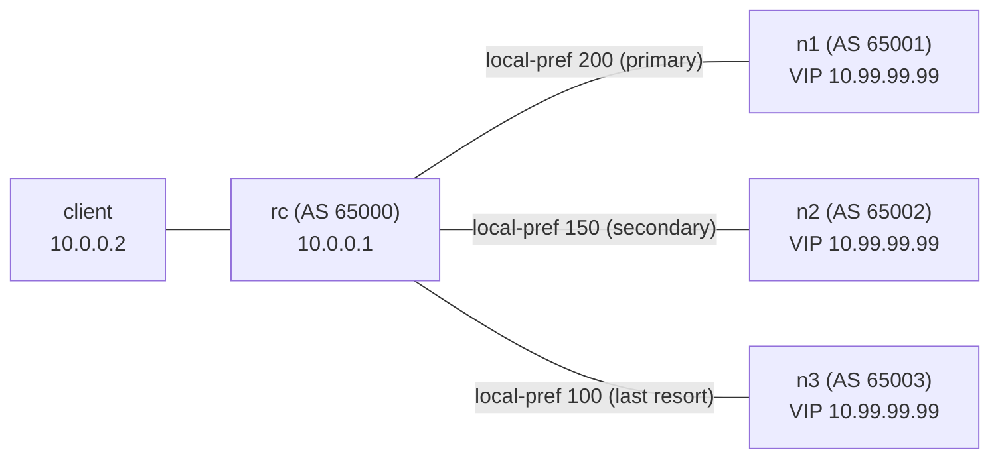

# 🌐 BGP Anycast Lab: breaking and healing a tiny "CDN" on my laptop

**Three servers announce the same IP address. One router decides which one answers. Then I break them one by one and watch what the network does.**

This lab shows eBGP with a routing policy, an anycast service, and the difference between three kinds of failure: a dead *link*, a dead *service*, and a *silent* failure. I measure every failover with a script and compare it to what the timer settings predict.

**Why not just one server and DNS?** In a traditional setup each server has its own address, so when one dies its clients keep going to it until DNS or a load balancer catches up. With anycast the *network* moves the traffic away within seconds, and the clients never change a thing.

**What the numbers should look like** (expected values derived from the timer settings; my own measurements are in [Results](#results-how-much-faster)):

- Silent-failure recovery: from up to **180 s** (default BGP hold timer) to about **1 s** with BFD, roughly **200× faster**.
- Service-failure recovery: from **never** (a black hole) to about **2 s** with the health check.
- Compared with a DNS failover on a 300 s TTL, anycast with a health check is about **150× faster** per incident.

  

---

## Why I built this

I was tired of *reading* about BGP. I wanted to see it route traffic, pick a path, lose a neighbor and recover.

Anycast is the idea behind how many CDNs and DNS providers serve the same IP address from many places. I wanted to find out what really happens when one of those places fails, and whether the network notices.

The result is a five-container lab that starts with one command and breaks in ways I chose.

## Why anycast instead of a traditional setup?

A traditional setup is one server (or an active/standby pair) behind a single address, with DNS or a load balancer deciding where clients go. It's simple and it works, until something fails.

| | Traditional (one address per server, DNS or load-balancer failover) | Anycast (this lab) |
|---|---|---|
| Where clients connect | One server or site, wherever it happens to be | The best healthy node for them |
| When a node dies | Clients keep using its address until the DNS record changes and caches expire (the TTL), or until a load balancer notices | Its route is withdrawn and the network sends traffic elsewhere |
| Recovery time is bounded by | The DNS TTL, which some resolvers ignore | BGP/BFD timers and the health-check interval: seconds |
| Client changes needed | Clients must re-resolve the name | None, the address stays the same |
| Adding capacity | New address, new DNS or load-balancer entries | Announce the same address from one more node |
| Single point of failure | The load balancer or DNS setup itself, unless duplicated | The nodes are interchangeable (in my lab the single router `rc` is the weak spot, see limitations) |
| Cost | Low complexity | More moving parts: BGP, health checks, careful design |

Anycast isn't magic: it needs routing expertise, and long-lived TCP connections can break when routes change (see limitations). I built this to understand when the extra complexity is worth it, and [Results](#results-how-much-faster) is where I check the claim with numbers.

## What's inside

- **5 nodes** running as containers: 1 client, 1 router (`rc`), 3 anycast servers (`n1`, `n2`, `n3`).
- **eBGP between 4 ASNs.** The router is AS 65000; each server has its own AS.
- **Anycast VIP `10.99.99.99/32`**, announced by all three servers from their loopback.
- **Routing policy:** `rc` uses local-preference to rank the servers (200, 150, 100), so I always know who should answer.
- **A health check** that withdraws the VIP from BGP when a server's web service dies.
- **Scripts** to watch failover live and to verify the lab state automatically.

Tools: [Containerlab](https://containerlab.dev), [FRRouting](https://frrouting.org), Docker, Python 3, a little shell.

## Topology



| Node   | AS    | Link to rc                   | Local-pref on rc |
|--------|-------|------------------------------|------------------|
| client | none  | 10.0.0.2/24 ↔ 10.0.0.1/24    | n/a              |
| n1     | 65001 | 10.0.1.2/30 ↔ 10.0.1.1/30    | 200              |
| n2     | 65002 | 10.0.2.2/30 ↔ 10.0.2.1/30    | 150              |
| n3     | 65003 | 10.0.3.2/30 ↔ 10.0.3.1/30    | 100              |

## Run it

**You need:** Linux (or WSL2 on Windows, or a Linux VM), Docker, [Containerlab](https://containerlab.dev/install/), and about 4 GB of free RAM.

```bash
git clone https://github.com/<your-username>/bgp-anycast-lab.git
cd bgp-anycast-lab
chmod +x scripts/*.sh scripts/verify.py

# 1. Start the lab
sudo containerlab deploy -t anycast.clab.yml

# 2. Check that everything is healthy and see who answers
python3 scripts/verify.py n1

# 3. In a second terminal, watch who answers twice a second (and keep a log)
mkdir -p logs && ./scripts/failover-test.sh | tee logs/run.log

# 3b. After a failure test, measure the outage from the log
python3 scripts/analyze.py logs/run.log

# 4. Look inside the router
docker exec -it clab-anycast-rc vtysh

# 5. Clean up
sudo containerlab destroy -t anycast.clab.yml --cleanup
```

If the FRR image tag in `anycast.clab.yml` doesn't pull, pick a current tag from [quay.io/frrouting/frr](https://quay.io/repository/frrouting/frr) and update it everywhere.

## What I tested

I kept `failover-test.sh` running in one terminal and wrote down the timestamps each time something changed.

### Test A: normal operation

On the router:

```
show bgp summary
show bgp ipv4 unicast 10.99.99.99/32
show ip route 10.99.99.99/32
```

What I expect, and what I checked: three Established sessions, three paths to the same VIP, and the best path via `10.0.1.2` (n1) because it carries local-preference 200. From the client, `curl http://10.99.99.99` answers `served by n1`.

<details>
<summary>My real output</summary>

<!-- Paste your own `show bgp ipv4 unicast 10.99.99.99/32` output here. -->

</details>

### Test B: a traditional baseline, then three ways to fail

| ID | What I broke | Command | What I expected |
|----|--------------|---------|-----------------|
| B0 | The **traditional baseline**: client talks to n1's own address, no anycast | loop below, then `docker exec clab-anycast-n1 ip link set eth1 down` | Nothing recovers: the address is tied to one server |
| B1 | A **link** (clean failure) | `docker exec clab-anycast-n1 ip link set eth1 down` | BGP drops the session immediately, traffic moves to n2 |
| B2 | A **service** (BGP still up) | `docker exec clab-anycast-n1 pkill httpd` | Black hole: the route stays but nothing answers |
| B3 | The same service, **with the health check** | `docker exec -d clab-anycast-n1 /healthcheck.sh 65001` then kill httpd | The VIP is withdrawn, traffic moves to n2 |
| B4 | A **silent failure** (packets vanish, link stays up) | `docker exec clab-anycast-n1 tc qdisc add dev eth1 root netem loss 100%` | The router waits for BGP timers to expire |

## Results: how much faster?

### Expected, from the settings (calculated, not measured)

These bounds come straight from the timers I configured, so you can check the arithmetic. My measurements below should land at or under them.

| What fails | Without the mechanism | With it | Gain |
|------------|-----------------------|---------|------|
| A service dies, BGP stays up (B2 → B3) | **never** recovers (black hole) | ≈ **2 s** (health check: 1 s sleep + up to 1 s wget timeout) | unbounded → 2 s |
| Silent failure, default timers → lowered timers (B4) | up to **180 s** (hold timer) | up to **9 s** (3 s / 9 s) | **20× faster**, 95% less downtime |
| Silent failure, default timers → BFD (B4, stretch) | up to **180 s** | ≈ **0.9 s** (3 × 300 ms intervals, check your FRR defaults) | **200× faster**, 99.5% less downtime |
| A server dies: DNS failover → anycast + health check | up to **300 s** (example 300 s TTL) | ≈ **2 s** | **150× faster**, 99.3% less downtime |

A link failure (B1) has no slower baseline in this lab: FRR drops the session as soon as the link goes down, so I expect about a second.

**Illustration, with assumptions stated:** say a node fails 12 times a year. With DNS failover on a 300 s TTL that is 12 × 300 s = **60 minutes** of downtime a year (99.989% availability for that cause). With anycast and a ~2 s health check it is 12 × 2 s = **24 seconds** (99.99992%). Your assumptions will differ; the point is how much the recovery time matters.

### How I measured

```bash
mkdir -p logs
./scripts/failover-test.sh | tee logs/b1.log     # in another terminal, break something; Ctrl-C afterwards
python3 scripts/analyze.py logs/b1.log           # outage per event
python3 scripts/analyze.py logs/b4-bfd.log 180   # 2nd argument = baseline seconds, prints the gain
```

For B0 (the traditional baseline), probe n1's own address instead of the anycast one:

```bash
while true; do
  printf '%s  ' "$(date +%T.%3N)"
  docker exec clab-anycast-client curl -s -m 1 http://10.0.1.2 || echo "NO ANSWER"
  sleep 0.5
done | tee logs/b0.log
```

The probe runs every ~0.5 s and curl waits up to 1 s, so every number is accurate to about ±1 s. Raw logs live in `logs/`, and the numbers I quote are collected in [`docs/results.md`](docs/results.md).

## What I learned

**1. A healthy BGP session does not mean a healthy service.**
B2 was the most useful five minutes of the project. n1's web server was dead, but n1 kept announcing the VIP because the BGP session was fine. The router happily kept sending traffic into a black hole. The fix is to let the node check its own service and withdraw the route when it fails, which is exactly what `healthcheck.sh` does. Routing health and application health are two different things.

**2. A link failure and a silent failure are very different problems.**
When a link goes down, FRR tears down the eBGP session straight away (fast external failover), so B1 should recover in about a second (my measurement is in Results). When packets silently vanish but the link stays up, the router has to wait for the BGP hold timer. With FRR's defaults (keepalive 60 s, hold 180 s) that can take minutes. Lowering the timers helps, and BFD is designed for exactly this: it detects the failure much faster than BGP can on its own.

**3. Why I used local-preference.**
I wanted a predictable "nearest" node, so I set local-preference on the router's inbound route-maps. The highest value wins, and it's checked before AS-path length. That made the lab deterministic: I always knew who should answer, so any surprise was a real finding. In a real anycast network, proximity comes from topology (AS-path length, IGP cost), not from a hand-set number, so this is a deliberate simplification.

**4. What `no bgp ebgp-requires-policy` does.**
By default, FRR won't accept or advertise routes on an eBGP session unless an inbound and outbound policy is attached. This follows the safe-by-default idea from RFC 8212. A session can show *Established* and still carry zero routes. I turned this check off to keep the lab simple, which is fine here but wrong for production, where you want prefix filters on every eBGP session.

## Limitations and next steps

**Limitations (on purpose, and worth being honest about):**

- **No route filtering.** The safety check above is disabled. A real network needs prefix-lists in both directions.
- **One router in the middle.** `rc` is a single point of failure; I only tested failures of the servers.
- **IPv4 only.**
- **Containers, not hardware.** Timings show the *behaviour*, not what production gear would measure.
- **Anycast is stateless.** If routing changed mid-connection, a long-lived TCP session would reset. The demo uses short, one-shot HTTP requests.

**Next steps:**

- [ ] Add BFD on every session and compare detection time against BGP timers.
- [ ] ECMP: equal local-preference with `maximum-paths 3`, plus `net.ipv4.fib_multipath_hash_policy=1` so different connections spread across nodes.
- [ ] Replace the policy bypass with real prefix-lists.
- [ ] Add IPv6.
- [ ] Generate all the configs from one YAML file, test them automatically, and add monitoring. That's my next project, `netctl`.

## Repo layout

```
bgp-anycast-lab/
├── README.md
├── anycast.clab.yml      # the whole topology
├── daemons               # which FRR daemons to start
├── configs/              # rc.conf, n1.conf, n2.conf, n3.conf
├── scripts/
│   ├── healthcheck.sh    # withdraws the VIP when the local service dies
│   ├── failover-test.sh  # prints who answers, twice a second
│   ├── verify.py         # checks sessions and the active next hop
│   └── analyze.py        # turns a failover log into outage times and gain
├── docs/
│   └── results.md        # the numbers I quote, with notes
└── logs/                 # failover-test.sh output, one file per test
```

## If something goes wrong

- **Session stuck in Active/Connect:** an IP is missing or an interface is down. Check `ip addr` and `ip link` inside the container.
- **Established but no routes:** a `network` statement for a prefix that isn't in the routing table (the VIP must be on `lo`), or the policy check above.
- **Config didn't load:** `docker logs clab-anycast-rc`, then `vtysh -c 'show running-config'`.
- **Stale state between runs:** `sudo containerlab destroy -t anycast.clab.yml --cleanup`, then deploy again.

---

Built by **<Your Name>** · [LinkedIn](https://www.linkedin.com/in/<your-profile>) · [GitHub](https://github.com/<your-username>)

If you spot a mistake or have a better way to do any of this, open an issue. I'm learning in public.
